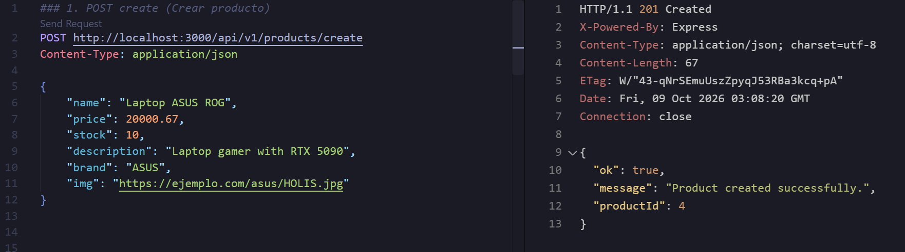
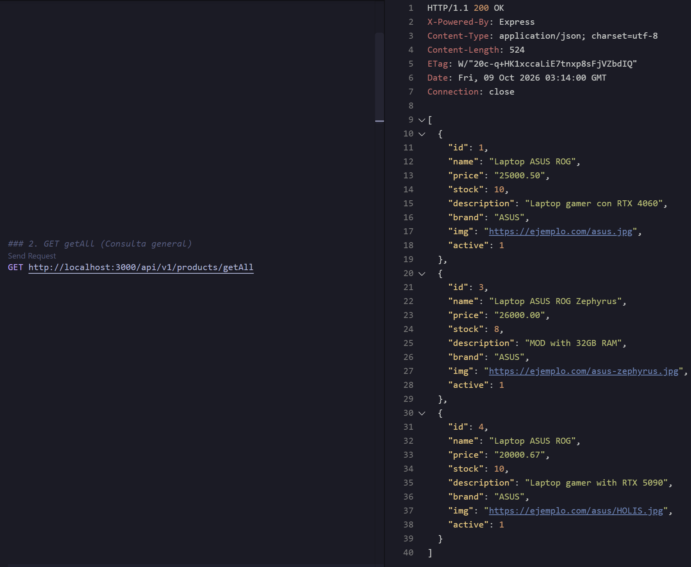
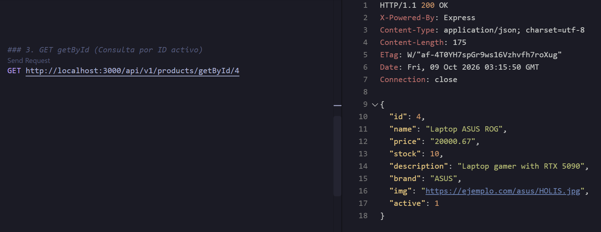
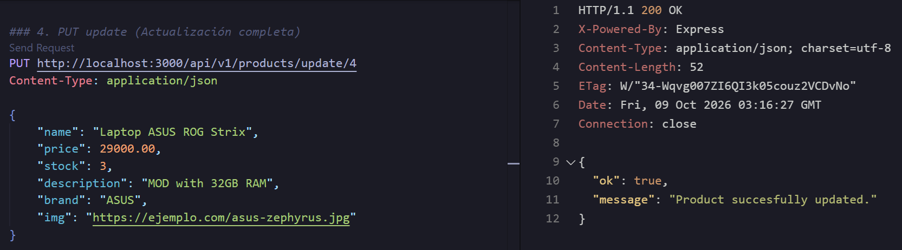
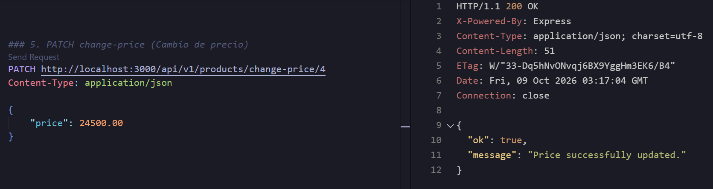
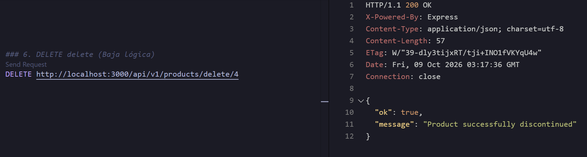

# API Testing Evidence

The following screenshots demonstrate the functionality and strict validation of the REST API, tested via the REST Client extension.

## 1. Product Creation (POST /api/v1/products/create)
Demonstration of a successful product creation. The server correctly processes the JSON payload, inserts the record into the MySQL database, and responds with a `201 Created` status code along with the new auto-incremented `productId`.

## 2. Active Product Queries (GET /getAll & GET /getById/:id)
Retrieving the list of all active products and fetching a specific product by its ID. The queries successfully return the newly created product, filtering by the `active = TRUE` flag.

## 3. Product Updates (PUT /update/:id & PATCH /change-price/:id)
Performing a full replacement of the product details (PUT) and a strict partial update modifying only the price (PATCH). The API validates the mathematical constraints (e.g., price > 0) and updates the database successfully.

## 4. Soft Delete (DELETE /delete/:id)
Executing a logical deletion. Instead of physically removing the record with a SQL `DELETE` statement, the API safely updates the product's `active` flag to `FALSE` to maintain the database history.

## 5. Soft Delete Verification
Verifying the integrity of the logical deletion mechanism. The deactivated product is correctly excluded from the `getAll` response, and attempting to fetch it directly via `getById` properly returns a `404 Not Found` error.

## 6. Error Handling and Input Validation
Testing the API's strict TypeScript and runtime validations. Submitting invalid data (e.g., a negative price or extra properties in a PATCH request) correctly yields a `400 Bad Request`. Requesting a non-existent ID yields a `404 Not Found`. All errors follow a standardized JSON format (`{ "ok": false, "message": "..." }`).

